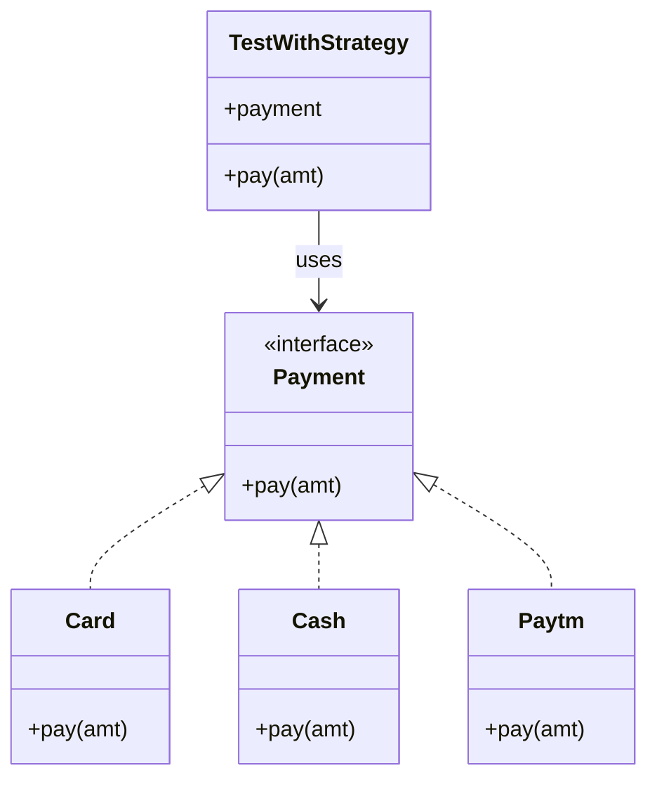
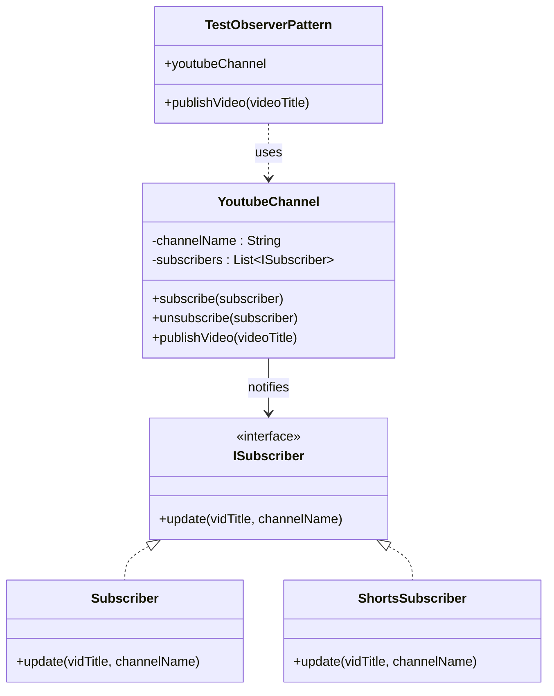

# Design Patterns in Java 🔒


---
# 1. Singleton

## What is a Singleton? 🤔
source: [SingleTonExample](./desingPattern/DesignPatternSingleton.java)

A Singleton ensures:

- only **one object** of a class exists in the JVM
- there is a **global access point** to get that object
- object creation is **controlled and restricted**


---

## 1) Double-Checked Locking (`volatile` + `synchronized`) ⚙️

### Snippet

```java
private volatile static DesignPatternSingleton INSTANCE;

public static DesignPatternSingleton getInstance() {
    if (INSTANCE == null) {
        synchronized (DesignPatternSingleton.class) {
            if (INSTANCE == null) {
                INSTANCE = new DesignPatternSingleton();
            }
        }
    }
    return INSTANCE;
}
```

### How this achieves Singleton

- `private` constructor prevents `new` from outside
- static field stores the **single shared object**
- first `if (INSTANCE == null)` avoids locking after initialization (performance)
- `synchronized` block ensures only one thread can create instance at a time
- second null check avoids duplicate creation in race conditions
- `volatile` prevents instruction reordering and guarantees visibility across threads

### Result

- ✅ Lazy initialization
- ✅ Thread-safe
- ⚠️ More code complexity

---

## 2) Holder Class Pattern (Initialization-on-Demand Holder) 🧠

### Snippet

```java
private static final class HolderClass {
    private static final DesignPatternSingleton INSTANCE = new DesignPatternSingleton();
}

public static DesignPatternSingleton getInstanceViaHolder() {
    return HolderClass.INSTANCE;
}
```

### How this achieves Singleton

- inner static class `HolderClass` is **not loaded immediately**
- JVM loads `HolderClass` only when `getInstanceViaHolder()` is called first time
- during class loading, JVM initializes static fields exactly once
- class initialization in JVM is thread-safe by design

### Result

- ✅ Lazy initialization
- ✅ Thread-safe without explicit synchronization
- ✅ Cleaner and easier to read than double-checked locking

---

## 3) Enum Singleton ✅

### Snippet

```java
enum SingleTonViaEnum {
    INSTANCE;
}
```

### How this achieves Singleton

- enum constants are created exactly once by JVM
- constructor for enum is controlled by JVM (cannot call with `new`)
- serialization keeps the same enum instance automatically
- reflection cannot create another enum instance

### Result

- ✅ Simplest implementation
- ✅ Thread-safe
- ✅ Serialization-safe
- ✅ Reflection-safe

---

## Quick Comparison 📊

| Approach | Lazy | Thread-safe | Serialization-safe | Reflection-safe | Complexity |
|---|---|---|---|---|---|
| Double-Checked Locking | ✅ | ✅ | ❌ (extra handling needed) | ❌ (can be broken) | Medium/High |
| Holder Class | ✅ | ✅ | ❌ (extra handling needed) | ❌ (can be broken) | Low |
| Enum Singleton | ✅* | ✅ | ✅ | ✅ | Very Low |

`*` Enum is initialized when the enum class is first actively used.

---

## Recommended Choice 🏆

- Use **Enum Singleton** when you want the most robust and concise Singleton.
- Use **Holder Class** when you need a classic class-based Singleton with clean lazy loading.
- Use **Double-Checked Locking** mainly when you explicitly want that style for learning/interview discussion.

---

## Example Usage 💡

```java
DesignPatternSingleton s1 = DesignPatternSingleton.getInstance();
DesignPatternSingleton s2 = DesignPatternSingleton.getInstanceViaHolder();

SingleTonViaEnum e1 = SingleTonViaEnum.INSTANCE;
SingleTonViaEnum e2 = SingleTonViaEnum.INSTANCE;

System.out.println(e1 == e2); // true
```
---

# 2. Builder

source: [DesignPatternBuilder](./desingPattern/DesignPatternBuilder.java)

# 🏗️ Builder Design Pattern

The **Builder Pattern** is a **creational design pattern** used to construct complex objects **step-by-step**.

It is especially useful when a class has **many optional parameters**, avoiding constructors with too many arguments.

---

## 🎯 Problem

Without Builder, you may end up with a constructor like:

```java
User user = new User(
    "John",
    "john@gmail.com",
    25,
    "Bangalore",
    "Developer",
    true
);
```

😵 Hard to read and easy to pass arguments in the wrong order.

---

## 💡 Solution

Use a Builder to construct the object step-by-step:

```java
User user = new User.Builder()
        .name("John")
        .email("john@gmail.com")
        .age(25)
        .city("Bangalore")
        .role("Developer")
        .active(true)
        .build();
```

Much more readable and maintainable. ✅

---

## 🧩 Simple Java Example

```java
public class User {

    private String name;
    private String email;
    private int age;
    private String city;
    private String role;

    private User(Builder builder) {
        this.name = builder.name;
        this.email = builder.email;
        this.age = builder.age;
        this.city = builder.city;
        this.role = builder.role;
    }

    public static class Builder {

        private String name;
        private String email;
        private int age;
        private String city;
        private String role;

        public Builder name(String name) {
            this.name = name;
            return this;
        }

        public Builder email(String email) {
            this.email = email;
            return this;
        }

        public Builder age(int age) {
            this.age = age;
            return this;
        }

        public Builder city(String city) {
            this.city = city;
            return this;
        }

        public Builder role(String role) {
            this.role = role;
            return this;
        }

        public User build() {
            return new User(this);
        }
    }
}
```

### Usage

```java
User user = new User.Builder()
        .name("John")
        .email("john@gmail.com")
        .age(25)
        .city("Bangalore")
        .role("Developer")
        .build();
```
---

## ⚖️ When Should You Use It?

Use Builder when:

* A class has **many fields**
* Many fields are **optional**
* Constructor has too many parameters
* You want **readable object creation**
* You want to create **immutable objects**

### Example

```java
new User.Builder()
    .name("John")
    .email("john@gmail.com")
    .build();
```

Instead of:

```java
new User("John", null, 0, null, null);
```

Also, libraries such as **Lombok** can generate builders: via `@Builder` annotation

---

# 3. Strategy

# 🎯 Strategy Design Pattern

source: [DesignPatternStrategy](./desingPattern/DesignPatternStrategy.java)

The **Strategy Pattern** is a **behavioral design pattern** that lets you define multiple behaviors and switch between them at runtime.

Instead of putting all payment logic in one class using `if-else`, each payment mode is moved to its own class.

---

## 🎯 Problem (Without Strategy)

Suppose we have different payment methods:

```java
void pay(int amt, String mode){
    if(mode.equals("CARD")){
        log.info("paid {} via card", amt);
    } else if(mode.equals("CASH")){
        log.info("paid {} via cash", amt);
    } else {
        log.error("{} mode is not accepted", mode);
    }
}
```

As more modes are added, this grows quickly and becomes harder to maintain.

- violates **Open/Closed Principle** (every new mode needs edits here)
- mixes multiple responsibilities in one method  by breaking **single-responsibility**

---

## 💡 Solution (With Strategy)

Create a common `Payment` strategy interface and separate classes for each mode (`Card`, `Cash`, `Paytm`).

```text
                    Payment
                      ▲
          ┌───────────┼───────────┐
          │           │           │
         Card        Cash       Paytm
```

---

## 🧩 Simple Java Example

### 1️⃣ Strategy Interface

```java
interface Payment {
    void pay(int amt);
}
```

### 2️⃣ Concrete Strategies

```java
class Card implements Payment {
    @Override
    public void pay(int amt) {
        log.info("paid {} via card", amt);
    }
}
```

```java
class Cash implements Payment {
    @Override
    public void pay(int amt) {
        log.info("paid {} via cash", amt);
    }
}
```

```java
class Paytm implements Payment {
    @Override
    public void pay(int amt) {
        log.info("paid {} via paytm", amt);
    }
}
```

### 3️⃣ Usage (Client Chooses Strategy)

```java
Payment card = new Card();
card.pay(100);

Payment cash = new Cash();
cash.pay(200);

Payment paytm = new Paytm();
paytm.pay(300);
```


---

## 🔄 Structure



---

## 🏆 Advantages

* ✅ Removes complex `if-else` / `switch`
* ✅ Better separation of concerns
* ✅ Easy to add new strategy classes
* ✅ Runtime flexibility by programming to `Payment` interface
* ✅ Each strategy can be tested independently

## 🌍 Real-World Uses

* 💳 Payment modes
* 📦 Discount algorithms
* 🔐 Authentication providers
* 🧮 Sorting/comparison strategies
* 🛣️ Route/path selection

---

# 4. Observer

# 👀 Observer Design Pattern

source: [DesignPatternObserver](./desingPattern/DesignPatternObserver.java)

The **Observer Pattern** is a **behavioral design pattern** where one object (subject) keeps a list of observers and notifies them on events.

---

## 🎯 Example Mapping

- `YoutubeChannel` and `YoutubeChannelWithMultiKindSubscriber` = subjects
- `ISubscriber` = observer contract
- `Subscriber` and `ShortsSubscriber` = concrete observers
- `publishVideo(...)` / `publish(...)` = event notification trigger

---

## 🔄 Structure (Mermaid)




## 🧩 1) Simple Observer Example (From Your Class)

### Observer Contract

```java
interface ISubscriber {
    void update(String vidTitle, String channelName);
}
```

### Subject

```java
class YoutubeChannel {
    private final String channelName;
    private final List<ISubscriber> subscribers = new ArrayList<>();

    public void subscribe(ISubscriber subscriber) {
        subscribers.add(subscriber);
    }

    public void unsubscribe(ISubscriber subscriber) {
        subscribers.remove(subscriber);
    }

    public void publishVideo(String videoTitle) {
        subscribers.forEach(s -> s.update(videoTitle, channelName));
    }
}
```

### Concrete Observer

🔄 How It Works
```text
1. Observer subscribes
   ↓
2. Subject stores observer
   ↓
3. Subject state/event changes
   ↓
4. Subject calls update()
   ↓
5. All observers react
```

```java

class Subscriber implements ISubscriber {
    @Override
    public void update(String vidTitle, String channelName) {
        log.info("Hey {}:{} you have new video notification {} from channel {}", id, name, vidTitle, channelName);
    }
}
```

### Test Usage (`TestObserverPattern`)

```java
YoutubeChannel sidChannel = new YoutubeChannel("SidChannel");
ISubscriber sid = new Subscriber("Sid", 1);
ISubscriber raj = new Subscriber("Raj", 2);
ISubscriber viju = new Subscriber("Viju", 3);

sidChannel.subscribe(sid);
sidChannel.subscribe(raj);
sidChannel.subscribe(viju);
sidChannel.unsubscribe(viju);

sidChannel.publishVideo("Observer pattern");
```

---

## 🧩 2) Multi-Kind Observer Example (Video + Shorts)

This version keeps separate subscriber lists per kind using `Map<String, List<ISubscriber>>`.

```java
class YoutubeChannelWithMultiKindSubscriber {
    private final Map<String, List<ISubscriber>> subscribersByKind = new HashMap<>();

    public void subscribe(String kind, ISubscriber subscriber) {
        subscribersByKind.computeIfAbsent(kind, ignored -> new ArrayList<>()).add(subscriber);
    }

    public void unsubscribe(String kind, ISubscriber subscriber) {
        subscribersByKind.getOrDefault(kind, new ArrayList<>()).remove(subscriber);
    }

    public void publish(String kind, String title) {
        subscribersByKind.getOrDefault(kind, new ArrayList<>())
                .forEach(s -> s.update(title, channelName));
    }
}
```

### Test Usage (`TestMultiKindSubscriberObserver`)

```java
YoutubeChannelWithMultiKindSubscriber channel = new YoutubeChannelWithMultiKindSubscriber("sidMultiChannel");

channel.subscribe("video", new Subscriber("raj", 2));
channel.subscribe("video", new Subscriber("manu", 3));
channel.subscribe("shorts", new ShortsSubscriber("sid", 1));

channel.publish("video", "Toxic new movie");
channel.publish("shorts", "Ramayana teaser");
```

---

## 🏆 Why This Is a Good Observer Example

## 🧠 Pattern Components

| Component | Responsibility |
|---|---|
| 🎯 Subject | Maintains observers and sends notifications |
| 👀 Observer | Defines the notification contract |
| 🔔 Concrete Observer | Performs action when notified |
| ➕ `subscribe()` | Adds an observer |
| ➖ `unsubscribe()` | Removes an observer |
| 📢 `notify()` | Notifies observers |

## 🌍 Common Use Cases

- 🔔 Notification systems
- 🎨 GUI event listeners
- 📡 Event-driven systems
- 📈 Stock price updates
- 💬 Chat applications
- 📨 Message/event systems
- 🌱 Spring application events

## 🆚 Observer vs Pub/Sub

| Observer | Pub/Sub |
|---|---|
| Subject directly knows observers | Publisher doesn't directly know subscribers |
| Usually in-process | Often uses a message broker |
| Direct notification | Message/channel based |
| Tightly connected to observer interface | More decoupled |


