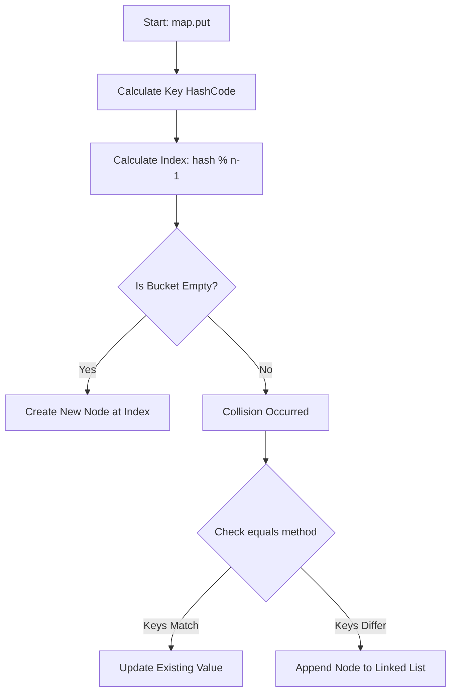

# ☕ Java Maps and Internals

---

  </img>

## 🏗️ Internal Data Structure
When you create a `HashMap` object, it internally initializes an array of **buckets**.

*   **Initial Capacity:** 16 buckets (indexed from 0 to 15).
*   **Bucket Composition:** Each bucket is essentially a **linked list** of Nodes or the red-black tree after a certain collision threshold after java8.
*   **Node Structure:** Every node contains four fields:
    *   `int hash`
    *   `K key`
    *   `V value`
    *   `Node next` (reference to the next node)

* hashmap allows 1 null key and multiple null val and it always stored in bucket 0 because we can't cal hash of null
---

## 📥 The `put()` Operation Flow
When you call `map.put(key, value)`, the following steps occur:

---

## ⚔️ Collision Handling
A **collision** occurs when two different keys result in the same bucket index.

1.  **The Process:** HashMap uses the `equals()` method to compare the new key with keys already present in the bucket's linked list.
2.  **Different Keys:** If `equals()` returns `false`, the new node is added to the end of the linked list.
3.  **Duplicate Keys:** If `equals()` returns `true`, the value for that existing key is replaced/updated.

---

## 🚀 Java 8 Optimization: Treeification
To prevent performance degradation in buckets with many collisions, Java 8 introduced a significant enhancement.

*   **Linked List to Tree:** When a bucket's linked list reaches a certain **threshold**(8) and capacity of 64 else it just doubles the buket capacity, it converts from a Linked List to a **Balanced Tree** (specifically a Red-Black Tree).
*  Note: 
   - size = number elements present in the map
   - capacity = the number of elements can map hold before resize
* **Benefit:** This improves the search time complexity within a single bucket from **O(n)** to **O(log n)**.

---

## 🛠️ Summary Table

| Feature | Details |
| :--- | :--- |
| **Default Capacity** | 16 Buckets |
| **Index Calculation** | Based on HashCode and Modulo/Bitwise operator |
| **Storage Unit** | Node (Hash, Key, Value, Next) |
| **Conflict Strategy** | Chaining (Linked List) or Balanced Tree (Java 8+) |

---

## 🔒 Thread-Safe Map Variants

### 🧱 `Hashtable`
- Synchronized legacy map implementation.
- Uses a single lock for most operations on the entire map, so contention is high and performance is usually lower than modern alternatives.
- Does **not** allow `null` keys or `null` values.

### 🧵 `Collections.synchronizedMap(map)`
- Wraps a normal `Map` and provides synchronized access using a single lock on the whole map.
- Thread-safe for individual operations like `get()` and `put()`.
- `null` handling depends on the wrapped map (for example, wrapping a `HashMap` still allows one `null` key and multiple `null` values).

### ⚠️ Iteration Note (`Hashtable` and `synchronizedMap`)
- Even if individual operations are synchronized, iteration still needs **external synchronization**.
- Without synchronizing on the map during iteration, concurrent updates can cause inconsistent behavior or `ConcurrentModificationException` (for fail-fast iterators).

### ⚡ `ConcurrentHashMap`
- Designed for high concurrency with much finer-grained internal synchronization than `Hashtable`.
- Reads are non-blocking in most cases and can happen concurrently with updates.
- Iterators are **weakly consistent**: they do not throw `ConcurrentModificationException` and reflect some state of the map during iteration and the value, next node pointer are volatile in nature.
- Does **not** allow `null` keys or `null` values.

### ✅ Quick Recommendation
- Use `ConcurrentHashMap` for shared mutable maps in multithreaded code.
- Use `Collections.synchronizedMap(...)` only when simple full-map locking is acceptable.
- Prefer `HashMap` in single-threaded usage.

NOTE: HashSet internally uses the HashMap itself with dummyObject as a value

