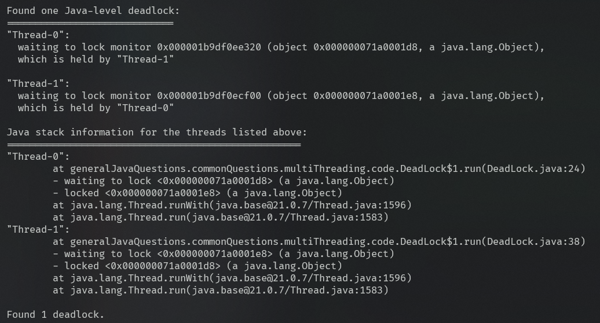

# 🧵1.  Daemon Threads in Java

Source: [DaemonThread.java](code/DaemonThread.java)
## 📌 What is a Daemon Thread?

A **Daemon Thread** is a background thread that provides support or services to **user threads**.

The JVM does **not** wait for daemon threads to finish. When all user threads complete, the JVM terminates the remaining daemon threads.

---

## ⚙️ Creating a Daemon Thread

Use `setDaemon(true)` **before** calling `start()`.

```java
@Slf4j
class DaemonThread {

    public static void main(String[] args) {
        /*Daemon thread will be terminated if no user thread is alive irrespective of it's current state
         * And this is not true for the non-daemon threads*/
        Thread dt2 = new Thread(() -> {
            while (true) {
                log.info("Hey i am daemon thread in infinite loop but will terminate if no user thread present");
                try {
                    Thread.sleep(1000);
                } catch (InterruptedException e) {}
            }
        });

        /*creation of daemon thread need to setDaemon(true) before starting the thread
         * if u set this flag after start it will throw IllegalThreadState and continue as user thread without failure
         * */
        dt2.setDaemon(true);
        dt2.start();
        log.info("This line to keep daemon alive for sometime");
    }
}

```

---

## 🔄 How It Works

```text
JVM Starts
    │
    ├── 👤 User Thread → main()
    │
    └── 👻 Daemon Thread → Background Task
              │
              ▼
       main() finishes
              │
              ▼
   No User Threads Remaining
              │
              ▼
       JVM Terminates 🚫
       Daemon Thread Stops
```

---

## ⚠️ Important Rules

* ✅ By default, threads are **User Threads**.
* 👻 Use `setDaemon(true)` to make a thread a daemon.
* ⏳ `setDaemon(true)` must be called **before** `start()`.
* ❌ Calling it after `start()` throws `IllegalThreadStateException`.
* 🚫 JVM does **not** wait for daemon threads to complete.
* 🔍 Check using `isDaemon()`.

```java
System.out.println(thread.isDaemon());
```

---

## 🆚 User Thread vs Daemon Thread

| Feature                  | 👤 User Thread        | 👻 Daemon Thread        |
| ------------------------ | --------------------- | ----------------------- |
| Keeps JVM alive          | ✅ Yes                 | ❌ No                    |
| JVM waits for completion | ✅ Yes                 | ❌ No                    |
| Default thread type      | ✅ Yes                 | ❌ No                    |
| Purpose                  | Main application work | Background/support work |

---

## 💡 Common Use Cases

* 🗑️ Garbage Collection
* 📊 Monitoring
* 🧹 Cleanup tasks
* 💾 Background auto-saving
* 🔄 Cache maintenance

---

# 🏎️ 2. Race Conditions in Java

Source: [RaceCondition.java](code/RaceCondition.java)

## 🤔 What is a Race Condition?

A **race condition** occurs when **multiple threads access shared data concurrently**, and the final result depends on the **timing or order of execution**.

---
## 🔥 Types of Race Conditions

### 1️⃣ Read-Modify-Write Race

Multiple threads read and update the same shared value.

```java
/*1. read-modify-write*/
class ReadModifyWrite implements Runnable{
    int count = 0;

    @Override
    public void run() {
        for (int i = 0; i < 10000; i++)
            count++;/*This is not atomic ops so intermediate ops can clash and miss the count */
    }
}

```
⚠️ `count++` is **not atomic**. It roughly performs:

```text
READ → MODIFY → WRITE
```

### 🧵 Possible Execution

```text
Initial count = 0

Thread 1 → reads 0
Thread 2 → reads 0

Thread 1 → writes 1
Thread 2 → writes 1

Expected → 2
Actual   → 1 ❌
```
---

### 2️⃣ Check-Then-Act Race

A thread checks a condition, but another thread changes the state **before the action happens**.

```java
/*2. check and act*/
@Slf4j
class CheckAndAct implements Runnable{
    int balance = 100;

    @Override
    public void run() {
        if (balance >= 100) { /*both thread may pass this at once*/
            log.info("withdrawing money...");
            balance -= 80;
            log.info("new balance is {}", balance);
        }
        else {
            log.info("low balance {}....", balance);
        }
    }
}
```

Possible issue:

```text
Thread 1 → balance >= 100
Thread 2 → balance >= 100 

Thread 1 → deducts -> balance = 20 
Thread 2 → deducts -> balance = -60 ❌ 
```

---

## 📌 Quick Summary

| Type                       | Pattern                          | Example                 |
| -------------------------- | -------------------------------- | ----------------------- |
| 🔄 **Read-Modify-Write**   | Read → Modify → Write            | `count++`               |
| 👀 **Check-Then-Act**      | Check → Act                      | `if (!exists) create()` |

## 🛡️ Solutions for Race conditions

`synchronized` • `Lock` • `AtomicInteger` • `Concurrent Collections`

---
# 🔒 3. Synchronization in Java

Source: [SynchronizedTest.java](code/SynchronizedTest.java)
## 🤔 What is Synchronization?

**Synchronization** is a mechanism that controls access to **shared resources** when multiple threads are running.

Its main purpose is to prevent problems such as **race conditions**.

> 🎯 **Only one thread can execute code protected by the same lock at a time.**

---

# 🧠 How Does `synchronized` Work?

Every Java object can act as a **monitor (intrinsic lock)**.

When a thread enters:

```java
synchronized (lock) {
    // Critical Section
}
```

The JVM follows this flow:

```text
Thread
   │
   ▼
Try to acquire the lock 🔒
   │
   ├── Lock available? ── Yes ──► Execute Critical Section
   │
   └── Lock held by another thread?
                    │
                    ▼
               Wait ⏳
                    │
                    ▼
             Lock Released 🔓
                    │
                    ▼
              Acquire Lock 🔒
```

When the thread exits the synchronized block, the lock is **automatically released**.

---

# 🧩 What is a Critical Section?

A **critical section** is the part of the code that accesses or modifies **shared data**.

```java
private int count = 0;

public void increment() {
    synchronized (this) {
        count++; // Critical Section
    }
}
```

Only one thread can execute this section at a time **for the same `this` object**.

---

# 1️⃣ `synchronized` Instance Method

```java
class Counter {

    private int count = 0;

    public synchronized void increment() {
        count++;
    }
}
```

An instance synchronized method locks the **current object (`this`)**.

It is approximately equivalent to:

```java
public void increment() {
    synchronized (this) {
        count++;
    }
}
```

### 🧵 Example

```text
Thread 1 → acquires Counter object lock 🔒
Thread 2 → waits ⏳

Thread 1 → finishes → releases lock 🔓
Thread 2 → acquires lock 🔒
```
---

# 2️⃣ `synchronized` Block

Instead of locking the entire method, you can lock only a specific section.

```java
class Counter {

    private int count = 0;

    public void increment() {

        // Non-critical code

        synchronized (this) {
            count++;
        }

        // More non-critical code
    }
}
```

This provides more control because only the **critical section** is locked.

---

### 🔐lock acquiring in instance synchronized method/block
>Note:
even if u have 2 instance synchronized methods/blocks and 2 threads sharing the same instance at a time only 1 synchronized block can run as
they fight for the `this` lock which is single as u r using the shared object

```java
class Example {

    public synchronized void methodA() {
        // ...
    }

    public synchronized void methodB() {
        // ...
    }
}

Example obj = new Example();

Thread t1 = new Thread(() -> obj.methodA());
Thread t2 = new Thread(() -> obj.methodB());

```
```text
methodA() ──┐
            ├──► obj 🔒
methodB() ──┘

Thread 1 → methodA() → 🔒 obj
Thread 2 → methodB() → ⏳ WAIT
```
---

# 3️⃣ Custom Lock Objects 🔐

You can create dedicated objects specifically for locking:

```java
class Bank {

    private int accountA;
    private int accountB;

    private final Object lockA = new Object();
    private final Object lockB = new Object();

    public void updateAccountA() {
        synchronized (lockA) {
            accountA++;
        }
    }

    public void updateAccountB() {
        synchronized (lockB) {
            accountB++;
        }
    }
}
```

### Why use multiple locks? 🤔

Imagine two independent resources:

```text
ONE Bank Object
      │
      ├── Account A → lockA 🔒
      │
      └── Account B → lockB 🔒
```

Now:

```text
Thread 1 → update Account A → acquires lockA 🔒
Thread 2 → update Account B → acquires lockB 🔒
```

Since `lockA` and `lockB` are **different objects**, the threads do not block each other **because of these locks**.

### 🎯 Important

> Different locks remove unnecessary blocking, but they **do not guarantee parallel execution**.

Parallelism depends on CPU resources and thread scheduling.

---
# 4️⃣ Multiple Class Instances vs Multiple Lock Objects

Consider:

```java
Counter counter1 = new Counter();
Counter counter2 = new Counter();
```

Each instance has:

```text
counter1 → Data 1 + Lock 1 🔒

counter2 → Data 2 + Lock 2 🔒
```

So threads accessing separate instances do not compete for the same instance lock.

But sometimes you want:

```text
ONE Shared Object
       │
       ├── Resource A → Lock A 🔒
       │
       └── Resource B → Lock B 🔒
```

Creating two instances would create **separate copies of the entire object and its data**.

Dedicated lock objects allow you to:

> Keep **one shared object**, while protecting different independent resources with different locks.

---

# 5️⃣ `static synchronized` Methods 🏛️

Example:

```java
class Example {

    public static synchronized void staticMethod() {
        // Critical Section
    }
}
```

A `static synchronized` method locks:

```java
synchronized (Example.class) {
    // Critical Section
}
```

The lock belongs to the **Class object**, not to an instance.

---

## 🧵 What Happens With Multiple Threads?

```text
Thread 1 → staticMethod()
           │
           ▼
      Example.class 🔒

Thread 2 → another static synchronized method()
           │
           ▼
          WAIT ⏳
```

Both methods require the same lock:

```text
Example.class 🔒
```

So only one can execute at a time whe u have multiple static synchronized methods/ blocks only 1 can run at a time.

---

# 6️⃣ Static Lock vs Instance Lock ⚔️

```java
class Example {

    public static synchronized void staticMethod() {
        // Locks Example.class
    }

    public synchronized void instanceMethod() {
        // Locks this
    }
}
```

```java
Example obj = new Example();
```

Now:

```text
Thread 1 → staticMethod()
           │
           ▼
    Example.class 🔒


Thread 2 → obj.instanceMethod()
           │
           ▼
         obj 🔒
```

These are different locks:

```text
Example.class ≠ obj
```

Therefore, the threads do **not block each other due to synchronization** and can execute concurrently.

---

# 🧩 Multiple Instances

```java
Example obj1 = new Example();
Example obj2 = new Example();
```

```text
Thread 1 → obj1.instanceMethod() → locks obj1 🔒

Thread 2 → obj2.instanceMethod() → locks obj2 🔒

Thread 3 → Example.staticMethod() → locks Example.class 🔒
```

All three locks are different:

```text
obj1 🔒

obj2 🔒

Example.class 🔒
```

Therefore, synchronization does not force these threads to wait for one another.

---

# 🧠 The Golden Rule

> 🔑 **Synchronization is always about the specific lock object.**

Two threads block each other **only when they need the same lock**.

```text
Same Lock 🔒
     │
     ▼
One thread executes
Other threads wait ⏳
```

```text
Different Locks 🔒 🔒
     │
     ▼
No waiting caused by those locks
```

---

# 📌 Quick Summary

| Synchronization Type            | Lock              |
| ------------------------------- | ----------------- |
| Instance synchronized method    | `this`            |
| `synchronized(this)`            | Current object    |
| `synchronized(lock)`            | Custom object     |
| Static synchronized method      | `ClassName.class` |
| `synchronized(ClassName.class)` | Class object      |

---
# 🔒 4. Deadlock in Java

Source:[DeadLock.java](code/DeadLock.java)

A **deadlock** occurs when two or more threads are **permanently waiting for each other to release a lock/resource**, so none of them can proceed.

---

## 🧠 Simple Example

```text
Thread 1                      Thread 2
   │                              │
   ├── 🔒 lock1                   ├── 🔒 lock2
   │                              │
   ├── ⏳ waits for lock2         ├── ⏳ waits for lock1
   │                              │
   └──────────── ❌ DEADLOCK ─────┘
```

---

## 💻 Java Example

```java
private static final Object lock1 = new Object();
private static final Object lock2 = new Object();

// Thread 1
synchronized (lock1) {
    synchronized (lock2) {
        // work
    }
}

// Thread 2
synchronized (lock2) {
    synchronized (lock1) {
        // work
    }
}
```

### 🔄 What happens?

```text
Thread 1 → holds lock1 → waits for lock2
Thread 2 → holds lock2 → waits for lock1

                 ↓
              DEADLOCK ❌
```

---

# ⚠️ 4 Conditions for Deadlock

All **four Coffman conditions** must exist simultaneously.

| Condition               | Meaning                                             |
| ----------------------- | --------------------------------------------------- |
| 🔒 **Mutual Exclusion** | Resource can be held by only one thread             |
| ✋ **Hold & Wait**       | Thread holds one resource while waiting for another |
| 🚫 **No Preemption**    | Resource cannot be forcibly taken from a thread     |
| 🔄 **Circular Wait**    | Threads wait for each other in a circular chain     |

### 💡 Prevention

Break **at least one** of these conditions to prevent deadlock.

---

# 🛡️ How to Prevent Deadlock

### 1️⃣ Consistent Lock Ordering ⭐

Always acquire multiple locks in the **same order**.

```java
// Thread 1
synchronized (lock1) {
    synchronized (lock2) {
    }
}

// Thread 2
synchronized (lock1) {
    synchronized (lock2) {
    }
}
```

```text
lock1 → lock2
   ↓
No circular wait ✅
```

---

### 2️⃣ 🔐 UseReentrantLock `tryLock()` ⏱️

`ReentrantLock` allows a thread to attempt acquiring a lock instead of waiting forever.

#### 🔐 ReentrantLock vs `synchronized` — Deadlock Prevention

The key advantage is that it provides APIs such as:

* `tryLock()` ⚡
* `tryLock(timeout)` ⏳
* `lockInterruptibly()` 🛑

These give us more control over lock acquisition and can be used to **avoid indefinite waiting**.

#### 💀 Deadlock with `synchronized`

```java
Object lock1 = new Object();
Object lock2 = new Object();

synchronized (lock1) {
    synchronized (lock2) {
        // work
    }
}

synchronized (lock2) {
    synchronized (lock1) {
        // work
    }
}
```

### 🔄 What happens?

```text
Thread 1                    Thread 2
   │                           │
   ▼                           ▼
lock1 🔒                    lock2 🔒
   │                           │
   ▼                           ▼
waits for lock2             waits for lock1
   │                           │
   └────────── 💀 DEADLOCK ─────┘
```

With `synchronized`, a thread **waits indefinitely** if another thread owns the monitor.


### ⚡ `ReentrantLock` + `tryLock()`

`ReentrantLock` allows us to **try acquiring a lock without waiting indefinitely**.

```java
Lock lock1 = new ReentrantLock();
Lock lock2 = new ReentrantLock();

if (lock1.tryLock()) {
    try {
        if (lock2.tryLock()) {
            try {
                // critical section
            } finally {
                lock2.unlock();
            }
        }
    } finally {
        lock1.unlock();
    }
}
```

If `lock2` is unavailable:

```text
tryLock()
   │
   ├── ✅ Available → acquire lock
   │
   └── ❌ Unavailable → return false
                          │
                          ▼
                     release lock1
                          │
                          ▼
                      retry later
```

This can **break the circular waiting situation** that leads to deadlock.


#### ⏳ Timed `tryLock()`

We can also wait for a limited amount of time:

```java
if (lock.tryLock(2, TimeUnit.SECONDS)) {
    try {
        // critical section
    } finally {
        lock.unlock();
    }
} else {
    // Could not acquire lock
}
```

```text
Wait up to 2 seconds
        │
        ├── 🔓 Lock acquired → continue
        │
        └── ⏰ Timeout → give up / retry
```
Reentrant lock doesn't guarantee that both thread get the lock it tries once if can't get just fail and move won't wai like normal synchronous lock


#### ⚠️ `ReentrantLock` can still deadlock!

Simply replacing:

```java
synchronized (lock1)
```

with:

```java
lock1.lock();
```

**does NOT solve deadlocks.**

For example:

```java
// Thread 1
lock1.lock();
lock2.lock();
```

```java
// Thread 2
lock2.lock();
lock1.lock();
```

This prevents **circular waiting**.

## 📊 `synchronized` vs `ReentrantLock`

| Feature                         | `synchronized` | `ReentrantLock` |
| ------------------------------- | :------------: | :-------------: |
| Mutual exclusion 🔒             |        ✅       |        ✅        |
| `tryLock()` ⚡                   |        ❌       |        ✅        |
| Timed lock ⏳                    |        ❌       |        ✅        |
| Interruptible lock 🛑           |        ❌       |        ✅        |  --> 
| Fairness option ⚖️              |        ❌       |        ✅        |
| Automatically prevents deadlock |        ❌       |        ❌        |


- Interruptible lock : Wait for the lock, but if someone interrupts me while I'm waiting, stop waiting and throw InterruptedException. 
- `lock.lockInterruptibly();`
- Fairness option: describes fairness as giving preference to the longest-waiting thread under contention, but scheduling and the exact acquisition method still matter
- `ReentrantLock unfairLock = new ReentrantLock(true);`
---

### 3️⃣ Avoid Nested Locks 🚫🔒

Avoid holding one lock while trying to acquire another whenever possible.

```java
synchronized (lock1) {
    synchronized (lock2) {
        // risky
    }
}
```

Prefer redesigning the code to require fewer simultaneously held locks.

---

### 4️⃣ Keep Critical Sections Small 🎯

Hold locks only for the operations that actually require synchronization.

```java
synchronized (lock) {
    // Only shared-state operations
}

callDatabase();
callExternalService();
```

This reduces lock contention and simplifies concurrency.

---

# 🔍 Detecting Deadlocks

For a running Java application:

```bash
jstack <PID>
```

Other useful tools:

* 🔎 **JConsole**
* 📊 **VisualVM**
* 🔬 **Java Flight Recorder / Mission Control**
* ☕ `ThreadMXBean`

A thread dump can reveal which thread owns a lock and which lock it is waiting for.

For my example
```cmd
.\jps.exe -lv
> output: 16932 generalJavaQuestions.commonQuestions.multiThreading.code.DeadLock -javaagent:C:\Program Files\JetBrains\IntelliJ IDEA Community Edition 2025.1.1.1\lib\idea_rt.jar=58503 -Dfile.encoding=UTF-8 -Dsun.stdout.encoding=UTF-8 -Dsun.stderr.encoding=UTF-8


.\jstack.exe 16932
> Java stack information for the threads listed above:
===================================================
"Thread-0":
        at generalJavaQuestions.commonQuestions.multiThreading.code.DeadLock$1.run(DeadLock.java:24)
        - waiting to lock <0x000000071a0001d8> (a java.lang.Object)
        - locked <0x000000071a0001e8> (a java.lang.Object)
        at java.lang.Thread.runWith(java.base@21.0.7/Thread.java:1596)
        at java.lang.Thread.run(java.base@21.0.7/Thread.java:1583)
"Thread-1":
        at generalJavaQuestions.commonQuestions.multiThreading.code.DeadLock$1.run(DeadLock.java:38)
        - waiting to lock <0x000000071a0001e8> (a java.lang.Object)
        - locked <0x000000071a0001d8> (a java.lang.Object)
        at java.lang.Thread.runWith(java.base@21.0.7/Thread.java:1596)
        at java.lang.Thread.run(java.base@21.0.7/Thread.java:1583)

Found 1 deadlock.
```

<p align="center">
  
</p>


---

### 🧠 Remember

**Deadlock = Holding one lock + Waiting for another + Circular dependency**

```text
L1 <──holds── T1
↑             │ waits 
│waits        ↓
T2 ──holds──> L2

 ❌ DEADLOCK
```
