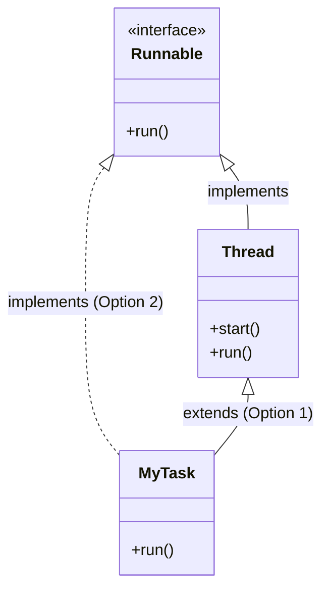
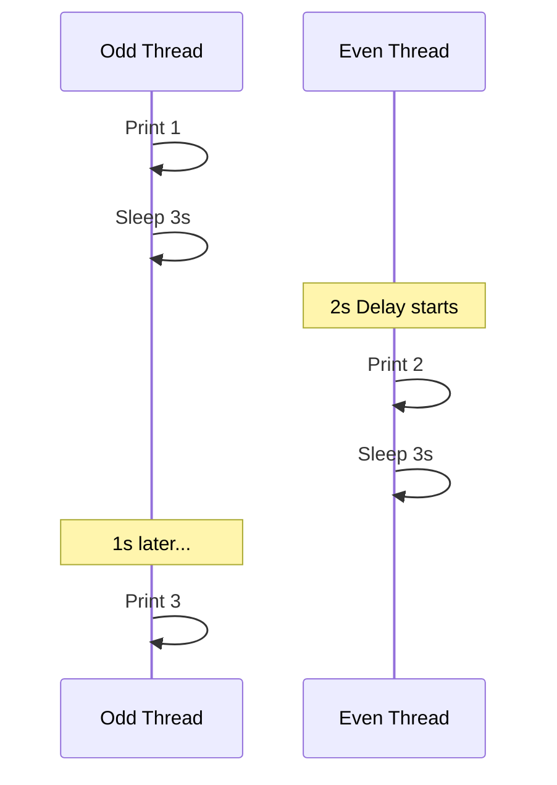

## 🛠️ Ways to Implement Multithreading
In Java, there are two primary ways to create and manage threads.

### 1. Extending the `Thread` Class
*   **How:** Create a class that `extends Thread` and override the `run()` method.
*   **Execution:** Call the `start()` method on the object to begin execution.

```java

@Slf4j
class ViaThreadClass extends Thread{

    @Override
    public void run() {
        log.info("This is the task executed by Thread extended class, Thread name {} ",Thread.currentThread().getName());
    }

    public static void main(String[] args) {
        ViaThreadClass viaThreadClass = new ViaThreadClass();
        viaThreadClass.start();
    }
}

```

### 2. Implementing the `Runnable` Interface
*   **How:** Create a class that `implements Runnable` and override the `run()` method.
*   **Execution:** Pass the `Runnable` instance into a `Thread` constructor and then call `start()`.

```java

@Slf4j
class ViaRunnableInterface implements Runnable{

    @Override
    public void run() {
        log.info("This is the task executed by runnable interface implementation, Thread name {} ",Thread.currentThread().getName());
    }

    public static void main(String[] args) {
        ViaRunnableInterface viaRunnableInterface = new ViaRunnableInterface();
        Thread thread = new Thread(viaRunnableInterface);
        thread.start();
        
        /*We no need to have the class which implements the Runnable interface to have a thread based execution we can just use
         * java 8 feature of lambda for anonymous function
         * */

        Thread viaLambdaAnonymousFun = new Thread(() -> log.info("this is the task executed by lambda impl of runnable anonymous fun, thread name {} ", Thread.currentThread().getName()));
        viaLambdaAnonymousFun.start();
    }
}
```

### 🧬 Thread Hierarchy & Relationship

*Note: The `Thread` class itself actually implements the `Runnable` interface.*

---

## ⚖️ `Thread` Class vs. `Runnable` Interface

| Feature | `extends Thread` | `implements Runnable` |
| :--- | :--- | :--- |
| **Inheritance** | Restricts further inheritance because Java doesn't support multiple inheritance. | **Recommended:** Allows the class to extend another parent class if needed. |
| **Complexity** | Simpler syntax for beginners. | Slightly more complex as it requires wrapping the object in a `Thread` instance. |
| **Boilerplate** | More code required per task class. | Can be greatly reduced using **Lambda Expressions** (Java 8+). |

---

## 🚦 Key Threading Concepts

### ⚡ `start()` vs `run()`
*   **`start()`**: This method is responsible for creating and registering a new thread, which then internally calls the `run()` method.
*   **`run()`**: If called directly, no new thread is created. The code executes sequentially within the **Main Thread**.

### ⏸️ Thread Control Methods
*   **`Thread.sleep(ms)`**: Pauses the currently executing thread for a specified number of milliseconds. It requires handling an `InterruptedException`.
*   **`join()`**: Tells the current thread (often the main thread) to wait until the target thread has finished its execution.

---

## 🎯 Interview Special: Odd & Even Numbers
A classic problem is printing numbers 1-30 in order using two separate threads (one for Odd, one for Even).

### 🔄 The Coordination Logic
To ensure they print in an alternate fashion (1, 2, 3...), you must coordinate them using `sleep()` timings:
1.  **Start Odd Thread**: Prints `1`, then enters a longer sleep (e.g., 3s).
2.  **Delay Even Thread**: Start the Even thread slightly later (e.g., 2s delay).
3.  **Alternate Execution**: The offset in sleep times allows the Even thread to "catch up" and print its number while the Odd thread is still sleeping, creating an ordered sequence.


